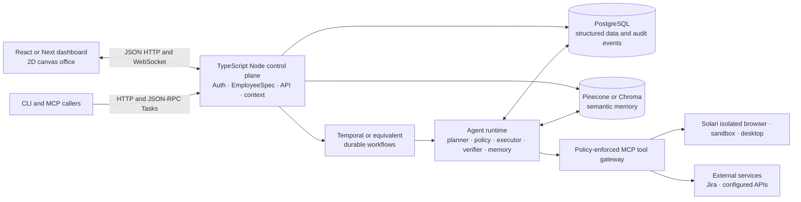
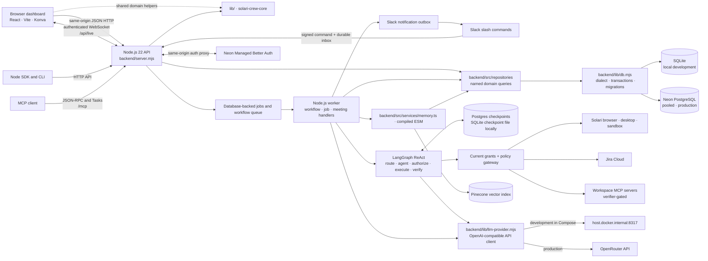

# CrewOS architecture

This describes the architecture in the current worktree. The research report contains a proposed destination stack; it is not a description of the implementation below.

## Report target architecture

The report's destination is a TypeScript/Node control plane, durable agent workflows, a guarded Solari execution plane, and a React dashboard. This diagram describes that target; the next section shows what the code currently runs.

## Current system

### Application and UI

- `backend/server.mjs` is the Node.js 22+ ESM application composition root. It uses Node's HTTP server directly and currently owns central URL dispatch, request context resolution, shared middleware, static asset delivery, and several larger legacy domain flows. System, authentication, employee-lifecycle, and background-job handlers have moved into `backend/src/controllers/`; additional route groups remain to be extracted. TypeScript modules compile from `backend/src/` into `backend/build/`; ESM modules under `src/` are imported directly.
- `backend/src/repositories/` contains named SQL operations grouped by application domain. The API composes repositories with traced database adapters; worker and service modules use the default repository instance. Controllers and services call repository methods instead of embedding queries. `backend/lib/db.mjs` remains responsible for database dialects, transactions, schema setup, and migrations.
- Shared validation, cookie, HTTP-body, agent-context, tool-schema, workflow, and simulation helpers live in `backend/src/utils/`. Password hashing remains under `backend/src/security/`.
- `backend/README.md` documents the backend folder layout and dependency rules. Controllers, route operations, repositories, reusable services, integrations, security/auth helpers, infrastructure helpers, and the Node SDK are grouped under `backend/src/`; the LangGraph pipeline and workflow snapshots live under `backend/workflows/`.
- `frontend/src/main.jsx` implements the manager and employee dashboard in React. `frontend/vite.config.mjs` uses the standard Vite workspace layout; `frontend/index.html` is the app entry and `frontend/dist/` is the production bundle. The service serves that built dashboard and static assets from `frontend/public/`, including the desktop viewer.
- The office floor plan uses a lazily loaded React/Konva scene. The lightweight overview retains a separate preview.
- The browser calls same-origin `/api/*` routes. `/api/live` sends authenticated workspace change notifications over WebSocket; desktop video uses the Solari stream path through the live viewer.
- The Node SDK in `backend/lib/client.mjs` and CLI in `backend/bin/crewos.mjs` use the same authenticated HTTP API. `/mcp` exposes the MCP JSON-RPC endpoint and Tasks extension.

### Shared core package

- `lib/` builds as the standalone `solari-crew-core` npm package. It has no runtime dependencies and does not call the database, providers, network, or LLMs.
- The package exports EmployeeSpec and provenance helpers, pure policy evaluation and tool catalogs, simulation scoring and simulated refund verification, meeting context and memory formatting, media type/evidence helpers, memory chunking and ranking, MCP/browser input checks, and workflow progress helpers.
- The frontend and backend import these functions by package name inside the npm workspace. `npm pack --workspace solari-crew-core` packages only the compiled JavaScript and type declarations for installation by another project.

### Workflow and policy path

New web, SDK/CLI, MCP, and Slack submissions create the same durable workflow record. A task stores its goal, creator, origin, idempotency key when supplied, employee spec version, deployment reference, and runtime version. New assignments use `langgraph-react-v1`; previously stored plan-based assignments keep their recorded legacy runtime.

The production API and worker are separate processes. Workers poll the database queue, claim work with an expiring lease and generation fence, heartbeat while running, and serialize active work per employee. Each verified step advances the persisted workflow cursor and result. The PostgreSQL deployment uses LangGraph's Postgres checkpointer; local SQLite development uses a separate LangGraph checkpoint file. A worker restart reclaims expired leases and resumes the graph from its checkpoint. Safe read-only tool calls can be retried with bounded backoff. External writes use a durable action ledger and provider-specific idempotency/reconciliation; an uncertain Jira write pauses for reconciliation instead of being blindly repeated. Workflow concurrency and background-job slots are bounded. Active browser objects remain process-local, so a running browser workflow is not yet a stateless multi-host service.

The ReAct graph has a route-selection node followed by an agent/tool loop. The router chooses among available public-search, browser, desktop, and workspace-tool families; task intent has deterministic fallbacks. The model can propose one tool call at a time, with a default limit of eight calls. For every call the backend checks the current employee deployment, current connected grants, input schema, policy, and lease; only then can the executor run it. The verifier checks the result before it is added to the next model turn. Failed public sources can be skipped and the agent can continue. The graph cannot mark a task complete without a nonempty final answer, verified task evidence, and any configured independent evaluation passing.

Policy denial fails the task. A policy requiring manager approval interrupts and checkpoints the graph with the exact tool and input; the approval is recorded against that action. An approval resumes the same workflow and graph checkpoint. Rejection ends the workflow without executing that action. Events, tool attempts, approvals, results, cursor, task status, snapshots, and background jobs are persisted. MCP discovery is available, but dispatch requires a trusted operator-provided ESM verifier (`MCP_VERIFIER_MODULE`) and independently verified postconditions; remote `readOnlyHint` is not evidence.

### Employee and deployment lifecycle

1. **Draft:** A manager hires an employee and saves an immutable, versioned `EmployeeSpec` containing identity, mission, responsibilities, success metrics, capabilities, grants, policies, and evaluation policy. Edits create a new spec version; editing an active employee returns it to probation.
2. **Probation:** The required probation suite runs the production ReAct graph against controlled adapters for each supported tool. It exercises success, approval, rejection, denial, and provider-failure behavior without creating live Jira issues or causing real payment side effects. The run records its spec version, runtime revision, policy revision, criteria, and evidence.
3. **Deployment:** In pilot mode, deployment is permitted only when the latest required suite passes for the current spec and matches the current runtime and policy revisions. A deployment row records the accepted evidence and revisions, then marks the employee active. A changed spec returns an active employee to probation. Each pilot assignment, approval resume, worker execution, and tool-effect boundary checks that the employee still has passing required probation and the latest deployment matches the current spec/runtime/policy plus the exact required run IDs. Work pinned to an older deployment remains blocked after redeployment. A policy revision therefore requires fresh probation and deployment before new pilot work can proceed. Live tool calls also check current policy immediately before effects. Full mode retains its existing deployment and simulation contract.
4. **Live assignment:** Only an active employee can receive a task. The workflow pins the employee spec version and deployment ID. Before each tool action, the backend rechecks current employee state/version, the manager's authority, current grants, connected providers, schema, and policy. A deployment change invalidates in-flight work rather than allowing it to run under stale permissions.
5. **Pause or archive:** A manager can pause/restore an employee; archiving is a soft archive that preserves history while blocking new work. Existing workflow state, evidence, versions, and audit history remain in the database.

The employee lifecycle describes the governed role and its authorization to accept work. It does not mean an employee is always running an LLM process: workers are activated by queued work and bounded background jobs.

### Context passed to an agent

For a new ReAct workflow, preflight builds the model context from the current task and employee, rather than sending the entire workspace history:

- The system prompt contains the employee's identity, mission, responsibilities, policies, evaluation policy, the task goal, and task-specific instructions. It marks memories, tool output, web pages, policies, and MCP descriptions as reference data that cannot change tool grants or system rules.
- The user message contains the goal, up to six ranked memories (bounded to about 6,000 serialized characters), and—when relevant—coworker context. Coworker context is a separate relational lookup, ranked by task terms and limited to four coworker profiles/relationship notes. These records are also marked untrusted.
- The tool registry contains only supported tools that are both granted by the current EmployeeSpec and connected/configured for this workspace. The route-selection call sees available route families; the task agent then sees only schemas for its selected families.
- Each model turn includes the graph's checkpointed messages: the task instructions, route summary, previous agent tool request, and verified tool output. Each tool result is capped before it is appended, and the graph proceeds one action at a time.

Legacy plan-based workflows assemble similar employee, goal, tool-schema, memory, and coworker context once for planning, then execute the persisted plan through the same policy and verification boundaries. Simulation context is only added to simulation runs. Neither path implicitly receives the user's full chat history; ongoing intent must be expressed as a task goal or captured in explicitly retrieved memory/context.

### Memory and recall

The relational `memories` table is the canonical source of truth. Rows are scoped to an organization and can be either organization-wide (`employee_id` is null) or private to one employee. An employee retrieves only its own memories and organization-wide memories. Every memory is queued for Pinecone indexing in an organization namespace with employee/org visibility metadata; SQL visibility checks are applied again when vector hits are loaded. The SQL row retains its embedding and indexing status, allowing lexical and local-vector fallback while Pinecone or the embedding provider is unavailable. A row is only marked `indexed` after Pinecone confirms the upsert.

Memory covers manager-authored records, source-grounded semantic passages from uploaded documents (including supported image/audio text extraction), episodic workflow outcomes, and completed meeting records. Workflow outcome memories are written only after verified completion or a recorded terminal failure, and known workflow/document/meeting source IDs are validated against persisted evidence. Canonical memory content and provenance remain in SQL. Deterministic whitespace normalization and a bounded title/type/body representation are used as embedding input; document text is split into source-linked passages before ingestion. No generated summary replaces the canonical record. Memory text is a recall aid, not an authorization source or hidden mutable agent state. Retrieval currently ranks by semantic and lexical relevance with a source/type boost, then passes records as untrusted reference context; policies, EmployeeSpec grants, and live authorization checks remain authoritative. The agent does not rewrite its role or permissions based on remembered outcomes.

Memory creation and indexing are separate: records and their `memory.index` jobs are committed together, then durable workers generate embeddings and upsert vectors. Index jobs retry with capped backoff until successful; pending/retrying records remain available through local retrieval. `npm run memory:migrate` queues an idempotent backfill for every existing memory, including records without embeddings. Deletion removes relational records and retries vector deletion; SQL revalidation prevents stale vectors from rehydrating deleted or unauthorized rows. Meeting memories are validated against completed agendas, decisions, actions, and messages. A memory is not automatically a promise that future goals will be scheduled or completed.

### What autonomy means in the current product

CrewOS provides **task-level autonomy**. A manager or connected caller states the outcome once; the agent chooses among the tools already available to that employee, carries out a bounded sequence of actions, checks each result, uses verified results to decide the next step, and returns a final answer. The manager does not have to prompt for each tool call. A worker can continue the same task after an approval or process restart from persisted workflow state. The queue also handles bounded retries for safe read-only operations.

Autonomy remains inside the submitted task, employee spec, tool grants, policies, verifier, and tool-call budget. A manager is brought back in when an action requires approval; policy denial, exhausted retries, verification failure, or uncertain external writes can fail or pause the task for review. Meeting agents may propose a narrow delegation, but a manager must accept it before a new workflow is created. Slack can submit a task once and report progress; it does not make agents continuously pursue an open-ended goal.

Full mode includes manager-defined recurring task schedules. A schedule stores a bounded task goal, employee, IANA timezone, and either a cron recurrence or elapsed interval. Managers can create, edit, pause, resume, delete, and inspect run history through the API; revision checks reject stale edits. The Node SDK mirrors these operations with `schedules`, `createSchedule`, `updateSchedule`, `scheduleRuns`, `pauseSchedule`, `resumeSchedule`, and `deleteSchedule`. The worker advances each due cursor atomically and creates an ordinary workflow with a stable occurrence key, so current employee deployment, manager authority, grants, policy, approval, and verification still apply. An unfinished prior workflow causes the due occurrence to be recorded as skipped; downtime is coalesced instead of replayed as an unbounded backlog. Run history exposes skipped reasons. Pilot mode excludes schedule navigation and management, rejects schedule API operations, and records due occurrences as skipped without dispatching work.

Schedules are static manager-authored recurrences, not a persistent goal engine or event-triggered planner that invents follow-up tasks. Queue polling also processes submitted work and durable jobs, not standing objectives. Broader goal autonomy would require explicit persisted goals (owner, scope, success criteria, constraints, budget, expiry), trusted triggers, a planner that proposes bounded next tasks, per-action policy and approval gates, stop/snooze/escalation controls, and auditable linkage from a goal to each generated workflow. Until then, describe CrewOS as an autonomous task executor, not an always-on autonomous employee.

Policy changes do not automatically transition active employees back to probation. In pilot mode, shared preflight checks now block assignment, approval resume, worker execution, and tool effects when required evidence or its deployment is stale; current policy is also checked at every tool effect. Full-mode behavior remains separate. See [`deployment-freshness.md`](docs/reviews/deployment-freshness.md) for the guard and focused regression evidence.

### Persistence and integrations

- `backend/lib/db.mjs` uses Node's built-in SQLite and local password sessions in development. Production uses `pg.Pool` with Neon’s pooled PostgreSQL URL and requires `NEON_AUTH_BASE_URL` for the matching Managed Better Auth branch. The current schema migration is 16; migrations use transaction-scoped advisory locks so they work through Neon’s transaction-mode pooler. The same-origin `/api/auth/neon/*` proxy preserves Neon’s httpOnly cookies and strips CrewOS-owned cookies; the API validates the Neon session before mapping the verified identity to the app's `users.auth_user_id`, workspace memberships, and role-scoped app session. Neon Auth owns passwords and identity; CrewOS retains workspace roles and invitations.
- Employee specs, versions, workflow/task state, events, integrations, meetings, simulations, and relational memory are stored in SQLite or PostgreSQL.
- Agent messages store a type, content, evidence IDs, and optional delegation goal. Delegation requests remain pending until a manager accepts or declines; acceptance creates a linked workflow that still passes through the planner, policy, executor, and verifier.
- Memory retrieval uses Pinecone dense similarity as the indexed search path, isolated by organization namespace, with SQL lexical/local-vector fallback during indexing or provider outages. Pinecone and an embedding provider are required for complete vector-search coverage; records remain pending and retry if either is unavailable. Development embeddings use the configured local OpenAI-compatible endpoint; production embeddings use OpenRouter.
- Solari handles isolated browser, desktop, and sandbox execution. Manager-only sandbox and desktop controls can save named snapshots, pause/resume an environment, and restore a saved snapshot; snapshot IDs are stored as workspace-scoped environment metadata. All model calls pass through `backend/lib/llm-provider.mjs`, which routes development traffic to the local endpoint (`127.0.0.1` for a host process, `host.docker.internal` for Compose) and production traffic to OpenRouter. Jira credentials and other integration secrets entered in Settings are encrypted with `APP_MASTER_KEY`; external MCP bearer tokens are also encrypted.
- Jira API calls run from the backend Jira adapter, and outbound MCP requests run from the backend policy gateway. Those calls pass through app authorization and policy checks but do not execute inside a Solari guest; reconcile this boundary with the report's broad isolation statement before production acceptance.

## Difference from the report's proposal

| Report proposal | Current implementation |
| --- | --- |
| TypeScript / Node.js | Node.js ESM; typed application modules are grouped by route, service, integration, security/auth, infrastructure, and SDK responsibility under `backend/src/`, then compiled to ESM before npm start/dev/test. The main API dispatcher, database persistence/migration layer, and Solari SDK execution adapter remain JavaScript |
| PostgreSQL as the structured database | Neon PostgreSQL and Managed Better Auth required in production; SQLite with local password auth for development; disposable PostgreSQL 17 acceptance and isolated production-image runtime probes pass locally, while live Neon acceptance remains open |
| Temporal durable workflows | PostgreSQL-backed queue and action ledger, LangGraph checkpoints, and separate API/worker processes |
| React or Next.js dashboard | React dashboard built with Vite; the desktop viewer remains a small static page |
| 2D canvas renderer | React/Konva office renderer |
| Pinecone or Chroma vector store | Pinecone is the eventual vector index; SQL remains canonical, with local lexical/vector fallback |
| Multimodal memory | Supported images and audio are converted to source-labeled text and use the document memory provenance/retrieval path; originals are not retained, and video/Solari replay ingestion is not implemented |
| All agent actions execute inside Solari environments | Browser, desktop, and sandbox tools do; Jira API and external MCP requests execute from the backend policy gateway, so the intended isolation boundary needs reconciliation |
| WebSocket office updates | Authenticated WebSocket change notifications plus HTTP refreshes |
| External MCP execution with verification | Discovery is available; a trusted operator verifier module is supported, but dispatch stays blocked until one is configured and independently verifies each action |

These differences keep local development runnable with few services. They do not imply the report's live, production, or deployment gates have passed. Code snapshot `4967723` passed the isolated Node 22/Python 3.12 release suite, production-image build, disposable PostgreSQL 17 acceptance, and local production-image health/readiness/graceful-shutdown probes. Those checks do not validate Neon, hosted CI, public TLS routing, external providers, production configuration, or a deployment. Live Neon acceptance, provider-backed acceptance, complete browser acceptance, and production deployment remain open. See [`docs/reviews/progress.md`](docs/reviews/progress.md) for the evidence and exact limits.

## Local startup

Run `npm start` with Node.js 22.5 or newer. SQLite is created under `./data` by default. See [README.md](README.md) for optional environment variables, provider setup, and the local demo.

## Private pilot boundaries

Native Slack OAuth, account linking, approved channels, signed commands, durable input deduplication, and a notification outbox are implemented independently of Solari browser profiles. Slack and web submissions create the same version-pinned workflows; risky actions are reviewed inside CrewOS. One Slack team maps to one CrewOS workspace.

Pilot probation exercises the production ReAct graph with controlled adapters for each supported grant. Deployment records bind the spec, runtime, policy revision and required runs. Jira issue creation includes a stable operation label and independent field/label verification; verified artifacts project into the dashboard and linked meeting actions follow workflow outcomes. An uncertain write is held for reconciliation. Recurring schedules are full-mode functionality and are disabled in pilot mode at the navigation, management API, and worker-dispatch boundaries.

Production pilot mode permits Jira creation, public search and simulated refunds. Browser/desktop automation, deletion, external MCP execution and autonomous schedules remain outside that release. Database migrations preserve existing history. See [PILOT_RUNBOOK.md](PILOT_RUNBOOK.md) for operations, restore procedures and the live acceptance checklist.
