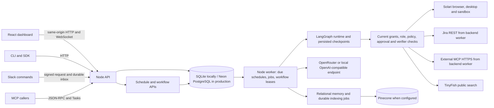
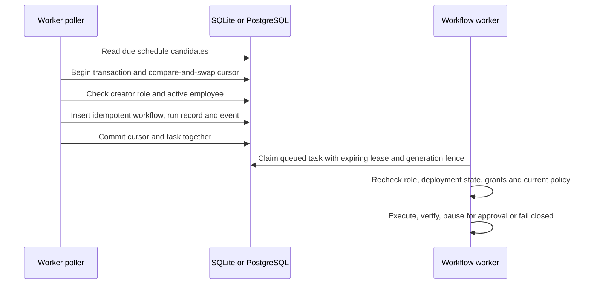

# CrewOS architecture and release assessment

Reviewed: 2026-10-25

Repository: `crewos/product-completion`. The original review used HEAD `ef39c7c` plus its then-current worktree; the subsequent broad assessment was reconciled at `72a8364` (historical). Scheduler and pilot-freshness source were rechecked in the tree at `bec81ee`; the latest recorded product-code release check is at `51ecc6b`.

Original review scope: read-only source and report review. The original reviewer did not run tests, contact providers, or make live calls.

Status reconciliation: updated 2026-10-25 using the release handoff and PostgreSQL 17 acceptance record. The release check and local PostgreSQL run are recorded at product-code HEAD `51ecc6b`; later commits `7828dd0`, `f9fd4dc`, and `bec81ee` changed documentation only. This review did not rerun checks or the harness. No live Neon or provider calls were made.

## Assessment

CrewOS has source paths for most of the original nine product phases. The implementation has moved from the proposed Temporal and Solari-only model to a smaller Node control plane, relational database, database-polled workers, LangGraph checkpoints, and selected direct provider connectors. That is a reasonable smallest architecture for the current product; a Temporal rewrite is not justified by the evidence.

The repository records a passing `npm run check:release` at product-code HEAD `51ecc6b`: 204/204 Node tests, 2/2 Python checks, source/build checks passed, and `npm audit --audit-level=high` found 0 vulnerabilities on host Node 26.8.2/Python 3.13.14 ([progress handoff](progress.md#L25-L34), [QA report](qa.md#L11-L17)). Later commits through `bec81ee` are documentation-only. The local PostgreSQL 17 acceptance also records a passing backup/restore ([acceptance](postgres-acceptance.md#L9-L30)). These are local results, not full release acceptance: CI's Node 22/Python 3.12 runtime, current production configuration, live Neon behavior and restore/recovery timing, live provider execution, external integration acceptance, and the complete browser journey remain open. This review did not rerun the checks or harness. The new schedule code has a sound transactional shape in source.

The private-pilot runbook excludes recurring schedules from pilot mode; manager-authored cron and interval schedules remain a full-mode feature. Source inspection confirms pilot mode hides schedule navigation, rejects schedule management operations, and records due occurrences as skipped while advancing the cursor. Existing tests cover the HTTP, worker-transition, and navigation boundaries, but this review did not rerun them. Pilot probation freshness is now guarded in source and covered by focused local tests; live/provider acceptance remains separate. The browser egress boundary remains incomplete and must be resolved before broad claims about isolated execution.

## Priority findings

| Priority | Finding and source evidence | Required decision or acceptance |
| --- | --- | --- |
| Resolved locally, pilot schedule boundary | The service uses the same PILOT_MODE source as `/api/config`, rejects manager schedule API operations in pilot mode, and records due occurrences as skipped while advancing their cursors. The dashboard hides schedule navigation in pilot mode. | Focused HTTP, worker-transition and navigation tests cover the boundary. The worker retains full-mode dispatch and skips pilot-time work before a later full-mode restart. |
| Resolved locally, database acceptance | The disposable PostgreSQL 17 harness covers competing schedule polls, two workers, approval restart, and backup/restore ([harness](../../scripts/check-postgres.mjs#L22-L45)); the recorded run at product-code HEAD `51ecc6b` passes ([progress](progress.md#L25-L34), [acceptance report](postgres-acceptance.md#L9-L30)). | Local backup/restore is evidenced. Live Neon behavior and restore/recovery timing remain open; this review did not rerun the harness. |
| Resolved locally, pilot probation freshness | `assertCurrentPilotDeployment` compares the current policy revision, runtime, exact required run IDs, and expected deployment ([guard](../../backend/workflows/probation.mjs#L87-L132)). The server applies it at assignment, approval resume, worker execution, and before tool effects ([server paths](../../backend/server.mjs#L1133-L1205), [execution/effect paths](../../backend/server.mjs#L1318-L1398)); focused regression coverage is in [`pilot-deployment-freshness.test.mjs`](../../test/pilot-deployment-freshness.test.mjs#L60-L140). | Resolved in local source/tests by `b2f5ab3`. This review did not rerun the tests; live/provider acceptance remains unverified. |
| P1, browser egress | Browser request interception checks public DNS, then continues the request without a pinned destination; the code comment records that provider egress pinning is pending ([Solari browser path](../../backend/lib/solari.mjs#L176-L185)). | Prove a provider-side egress rule or controlled proxy before claiming a complete SSRF/east-west network boundary. |
| P2, connector trust boundary | Jira and external MCP are direct backend-worker requests, outside Solari ([Jira adapter](../../backend/src/integrations/jira.ts#L157-L209), [MCP request](../../backend/src/integrations/mcp.ts#L83-L94)). | Treat the worker as a privileged execution service with narrow outbound rules and protected credentials. Clarify the Solari-only statement in the original research contract. |
| P2, unattended recovery | Jira has operation lookup/read-back. Unknown outcomes for other started writes fail closed for reconciliation rather than retrying ([tool ledger and recovery](../../backend/server.mjs#L1285-L1329)). | Keep this fail-closed behavior. Add a provider-specific reconciliation path before advertising unattended restart recovery for each write connector. |

## As-built architecture

The API and worker are separate process roles in production, built from the same Node application. The worker polls the database for due schedules, queued workflows and background jobs. PostgreSQL is the production system of record; local development uses SQLite and a separate LangGraph checkpoint file. The database stores organizations, memberships, employee specs and deployments, workflows, tool runs, approvals, schedule definitions and occurrences, events, meetings, jobs, and canonical memory records.

The central objects are:

- Workspace identity: organization, user, membership role, and authenticated session.
- Employee: current state, immutable EmployeeSpec version, tool grants, and deployment evidence.
- Workflow/task: organization, employee, creator, goal, runtime/spec/deployment references, idempotency key, status, lease generation, step cursor, and result.
- Tool run: one workflow step, exact tool/input, operation ID, attempts, output and verification.
- Approval: workflow/request key, action fingerprint, reviewer, state, and expiry.
- Schedule: employee, creator, goal, cron or elapsed interval, IANA timezone, status, next cursor, and optimistic revision.
- Schedule run: one due occurrence, linked workflow or skipped reason, and due timestamp.

The manager dashboard and SDK submit ordinary workflow records. The private pilot also accepts Slack task submissions. MCP exposes the task API. All paths converge on the same policy-gated workflow runtime. Memory is relationally canonical; vector search is an index, not an authorization source.

## Authentication, observability and deployment assumptions

API requests use the app session and workspace membership; Neon Managed Better Auth is proxied through the app in production, while local development can use local password sessions. Manager access is required for scheduling and most lifecycle-changing APIs. The worker does not trust the schedule's original role snapshot: it reloads the saved creator's current membership at due time, then tool execution checks the creator again.

The operational signals are concrete but do not replace acceptance:

- JSON logs include request IDs and route, database and provider spans; the README says credentials and request bodies are omitted.
- Workflow and schedule transitions are stored as events. Tool attempts, approvals, verification and workflow snapshots provide audit evidence.
- The dashboard exposes schedule run history and skipped reasons, and Reports exposes job failures and retries.
- /api/health is liveness. /api/ready requires a responsive database and a recent worker heartbeat.

Production assumes Node 22, a PostgreSQL database, branch-matched Neon Auth, an API process and at least one worker process from the same image. The worker heartbeat is required for readiness. Database migrations and application code must be deployed in a compatible order; do not roll back to an image that cannot read the current migration history. PostgreSQL backup alone does not preserve the encryption key needed for integration secrets, so back up APP_MASTER_KEY separately. Local LangGraph checkpoints are stored in a separate SQLite file from the main application database, so a manual local backup must include both files. The recorded disposable PostgreSQL 17 acceptance passed backup/restore; live Neon restore behavior remains unverified.

## Pilot and full deployment modes

PILOT_MODE is a process-wide deployment switch, not a per-workspace plan. Production defaults to true. Pilot grants are limited to Jira issue creation, public search, and the simulated refund tool. Pilot deployment requires current required probation evidence. PILOT_MODE=false enables the broader tool registry; employees still need a passing simulation for the current spec before deployment, and each action remains subject to current role, tool-grant, schema, and policy checks. Refunds remain simulated in either mode.

| Boundary | Current behavior | Assessment |
| --- | --- | --- |
| Pilot tools and probation | Global PILOT_MODE gate; production defaults to the restricted mode. | Matches the private-pilot contract. |
| Full mode | Same service with PILOT_MODE=false and the wider connected tool catalog. | Adequate as a deployment mode. It is not a separate tenant entitlement system. |
| Schedules | Pilot mode hides schedule management, rejects schedule API operations, and records due occurrences as skipped while advancing the cursor; full mode retains the schedule page, API and worker dispatch. | Matches the runbook boundary. Full-to-pilot-to-full transitions do not replay occurrences skipped during pilot mode. |
| Live actions | Current employee state/spec, creator manager role, current grants and current policy are rechecked at execution; pilot mode also requires current deployment evidence. | Local source/tests cover the pilot freshness gate. This is not live/provider acceptance. |

**Pilot schedule boundary (per `PILOT_RUNBOOK.md`):** The UI does not offer schedule management, the API rejects schedule operations, and the worker does not create scheduled workflows in pilot mode. When a due occurrence arrives during pilot mode, the worker records it as skipped and advances the cursor in the same transaction. This prevents a full-mode restart from replaying pilot-time work while preserving run history.

## Schedule contract and atomicity

The schedule API is manager-only: GET/POST /api/schedules, PATCH/DELETE /api/schedules/:id, POST /:id/pause and /:id/resume, and GET /:id/runs. Inputs require an active employee, bounded task instructions, either a five-field calendar rule with a valid IANA timezone or an elapsed-time interval, and a revision for edits/status changes. Delete archives the definition while retaining its run history.

A worker reads due rows, then uses a database transaction and compare-and-swap update on status, next_run_at and revision. In full mode, that transaction checks the saved manager membership and employee state, inserts the ordinary workflow with an occurrence-derived idempotency key, records the schedule run and audit event, and advances the cursor. In pilot mode, it records a skipped run and advances the cursor without creating a workflow. The schedule_runs table also has a unique schedule/due-time constraint. The transaction adapter uses BEGIN IMMEDIATE for SQLite and one pinned PostgreSQL client per transaction. The workflow insert has a unique organization/idempotency key constraint.

This design gives each due occurrence one database claim and one workflow record when the database transaction and uniqueness constraints behave as intended. If dispatch throws a transient/server error, the transaction rolls back and the due cursor remains available. If the process stops after commit, the queued workflow remains for the worker. This is stronger than an in-memory timer and does not require a new scheduler service.

The scheduler intentionally coalesces downtime to one run and computes the next cursor from the poll time. If the previous schedule workflow is still nonterminal, including a pending approval, the occurrence is recorded as skipped and is not replayed later. The UI exposes run history and a skipped reason. These are explicit loss/coalescing semantics, not exactly-once external side effects.

**Verification state:** local SQLite schedule tests cover timezone/DST rules, revisions, cross-workspace access, creator revocation, overlapping runs, downtime coalescing and transient rollback. The QA report records six additional schedule regressions passing. The later PostgreSQL 17 acceptance in [`postgres-acceptance.md`](postgres-acceptance.md) records competing schedulers, one schedule occurrence, two workers, approval checkpoint restart, and backup/restore passing. This review did not rerun that harness. Live Neon behavior remains unverified.

## Authorization, approvals and side-effect recovery

A schedule creator must be a current manager when an occurrence is dispatched. The employee must be active. Workflow creation pins the current spec/deployment reference. Before a tool action, the worker verifies its lease, employee active state and spec version, the workflow creator's current manager role, current grant and provider connection, input schema, and current policy. A changed employee state/spec or revoked manager therefore stops a later action. Policy decisions are server-side; model output, task text, retrieved memory, web content and MCP descriptions do not grant permissions.

An approval is keyed by workflow step and a canonical fingerprint of the exact tool/input. It expires after 24 hours and is consumed with a conditional database update; resumption uses the graph checkpoint. A different action, stale approval ID, or expired approval is rejected. This protects the approval path from being reused for altered input.

For writes, the tool-run row is the action ledger. Jira create uses the stable tool-run ID as an operation label and can read back the matching issue before resuming. Safe read-only tools have bounded retry. If another external action was started but the outcome is uncertain after a restart, the worker fails closed for reconciliation rather than blindly repeating it. Saved MCP Tasks IDs can be resumed; if dispatch succeeded but the task/result ID was not persisted, automatic reconciliation is not established. This favors duplicate prevention over unattended recovery.

A control-plane worker can still lose its lease while a remote provider call is in flight. The lease fence prevents the stale worker from committing workflow state; it cannot retract an external request already sent. Every write path therefore needs either provider idempotency/reconciliation or a clear manual reconciliation state. Jira has a dedicated path; generic MCP and Solari writes do not have a common provider-independent exactly-once mechanism.

Pilot probation freshness is resolved locally. The current guard rejects work when the stored deployment's policy revision, runtime, exact required run IDs, spec, or expected deployment no longer match the accepted evidence. The server invokes this guard at assignment, approval resume, worker execution, and tool-effect boundaries ([guard](../../backend/workflows/probation.mjs#L87-L132), [server](../../backend/server.mjs#L1133-L1205) and [effect path](../../backend/server.mjs#L1388-L1398)); the focused regression test exercises policy changes and stale queued/approved work ([test](../../test/pilot-deployment-freshness.test.mjs#L60-L140)). This is local source/test evidence only; no live provider acceptance was performed.

## Service boundary and security findings

The research proposal says all agent actions happen in Solari isolated environments. That is not the current boundary. Browser, desktop and sandbox calls go to Solari. Jira REST calls and external MCP HTTPS calls are made directly by the CrewOS backend worker; simulated refunds are written in CrewOS's database. The worker also holds/decrypts connector credentials. Treat the worker and its egress rules as a trusted execution boundary. The current architecture document already identifies this difference; the product security language should say that only browser/desktop/sandbox execution is in Solari.

External MCP has meaningful local defenses: HTTPS-only public endpoint checks, DNS resolution and address pinning for each request, bounded responses, schema validation, encrypted optional bearer tokens, and a trusted operator verifier. Dispatch is blocked before network access unless canVerifyMcpPostcondition returns true; successful task completion requires the verifier hook. The verifier is imported as trusted server code and receives sensitive connection context, including a decrypted token during verification. It must be reviewed and deployed like privileged application code, never supplied by a workspace user. No live MCP dispatch is accepted until a live test server and independent postcondition read-back are verified.

The browser path has a concrete egress risk. CrewOS checks host resolution before navigation and on intercepted requests, but the request is then continued from remote Chromium without passing a pinned address. The source comment explicitly says to pin provider egress when Solari exposes that control. A DNS change between CrewOS's check and the remote browser connection could invalidate the check. Treat browser-host validation as filtering, not a complete SSRF or egress boundary, until a provider-side control or controlled proxy is proven.

## Original nine-phase scope

| Phase | Implementation evidence | Verification or remaining work |
| --- | --- | --- |
| 1. Tenant accounts and roles | Auth, workspace setup, roles, invitations and scoped repositories are present. | Local request-path evidence exists. Verified Neon signup/invitation, role revocation and two-workspace isolation remain account/browser gates. |
| 2. Isolated execution | Solari browser, desktop and sandbox adapters, live view, recordings, and lifecycle controls are present. | Live sandbox echo is reported; browser/desktop, profile-backed login, replay, launch-time target and egress boundary remain open. Sandbox command output does not provide provider recording/replay evidence. |
| 3. Policy runtime | LangGraph route/authorize/execute/verify path, exact approvals, tool ledger, leases, idempotent workflow submissions and reconciliation are present. | Local tests and the disposable PostgreSQL 17 checkpoint/recovery acceptance pass. Real Neon, Jira, and live external MCP acceptance remain open. |
| 4. Knowledge and memory | Source-linked documents, relational canonical records, lexical/local-vector fallback and Pinecone indexing are implemented. | A Pinecone round trip is reported in the scope review. Retrieval relevance, provenance quality, outage recovery and tenant isolation need target-environment acceptance. |
| 5. EmployeeSpec | Versioned spec compilation/editor and field provenance are present. | Local request-path tests exist. Run the source upload, model draft, manager edit and version history in the browser with the configured provider. |
| 6. Probation and simulation | Pilot required probation uses the production graph with controlled adapters and simulated outcomes; deployment records runtime/spec/policy evidence. | This is not live Solari simulation evidence. Full mode uses a passing simulation for the current spec; browser-backed scoring and replay acceptance remain open. |
| 7. Office and live view | React/Konva office, workspace status updates and viewer paths are implemented. | Integrated browser journey still needs keyboard, reconnect, role authorization and UI-failure checks. |
| 8. Meetings and collaboration | Persistent meeting records, brief/discussion/decision flows and manager-approved workflow follow-ups are present. | Local flows exist. Meetings are manager-started; calendar-triggered meeting execution and live two-employee acceptance remain open. |
| 9. Analytics and independent evaluation | Reports, usage data, SDK/CLI and evaluator support exist. | A distinct evaluator is optional in configuration, and the README says evaluator failures do not change task completion. To claim Phase 9 acceptance, configure and prove a distinct evaluator in the release path. Automated retraining is excluded by the completion brief. |

The new manager-defined schedule capability is a completion-contract feature layered onto these phases. It is a bounded, static recurrence that creates normal guarded tasks. It does not implement an event-triggered planner or open-ended persistent goals, and should not be described as a continuously self-directed employee.

## Missing work and account-dependent gates

| Gate | What is implemented | What remains unverified or blocked |
| --- | --- | --- |
| PostgreSQL and release operations | `npm run check:release` passed at product-code HEAD `51ecc6b`: 204/204 Node tests, 2/2 Python checks, source/build checks, and 0 high-severity audit findings on host Node 26.8.2/Python 3.13.14 ([progress](progress.md#L25-L34)). The disposable PostgreSQL 17 run at that code HEAD records migrations, competing schedulers, two-worker processing, approval restart, and backup/restore passing ([acceptance](postgres-acceptance.md#L9-L30)). Commits through `bec81ee` after that code HEAD are documentation-only. | This review did not rerun either check. CI's Node 22/Python 3.12 runtime remains unverified; the production configuration doctor failed on the recorded local configuration. Live Neon behavior, including Neon-specific restore/recovery procedure and timing, remains unverified. |
| Neon identity and tenancy | Same-origin Managed Better Auth proxy and workspace role mapping. | Verified owner and second-user inbox, invite acceptance, revocation, reset/verification email, and tenant isolation on the configured branch. |
| Slack | Signed commands, account linking and outbox paths. | Slack app OAuth/admin consent, approved test channel, command delivery and notifications. |
| Jira | OAuth 3LO, project selection, create/read-back and reconciliation code. | Human Atlassian consent and one disposable project for create/read-back/worker-interruption acceptance. |
| Solari | Browser, desktop, sandbox, profiles, snapshots, stream and replay code. | Browser/desktop acceptance, profile login and replay, actual sandbox/desktop lifecycles, and a tested network-egress control remain open. The earlier browser `FeatureRequiresPlan` response came from `stealth: true`; current source uses `stealth: false`, and the integration review says no stealth upgrade is required for this browser path. That old response does not establish a current browser upgrade requirement. Live account entitlement/spend behavior remains unverified ([prior result](scope.md#L14-L18), [current launch source](../../backend/lib/solari.mjs#L307-L333), [integration review](integrations.md#L12-L14), [egress review](integrations.md#L34)). |
| Model/vector | Local development and OpenRouter/Pinecone adapters. | Live retrieval quality, provider outage behavior, and a configured distinct evaluator for Phase 9. |
| External MCP | Discovery, encrypted tokens, input checks and verifier hooks. | Trusted operator verifier plus live HTTPS test endpoint and independently verified postcondition. Until then dispatch remains blocked. |
| Full product journey | Individual request paths and local tests. | One recorded browser run from setup/invitation through knowledge/spec, probation/deploy, scheduled task, approval, verified evidence and meeting follow-up. |

No live account actions or paid calls were made during this review. Live provider gates require the account owner's consent and a disposable staging workspace; no account secret is needed for this architecture report.

## Alternatives and testable decisions

1. **Keep the DB-backed scheduler.** It reuses the application's existing source of truth and makes cursor advancement and task insertion atomic. The disposable PostgreSQL 17 acceptance supports this choice. A separate scheduler or Temporal would add infrastructure and migration work without changing the remaining live Neon and product-scope gates. Revisit only if the product needs long-running timers, event-driven goals, very large timer volume, or richer catch-up/compensation than one bounded poll can provide.
2. **Keep direct Jira/MCP connectors, but define the trust boundary honestly.** API connectors have structured request/read-back semantics and fit the existing policy gateway. Routing them through Solari would broaden the isolated-execution claim but add credential forwarding and a second network hop. The minimal design is a tightly scoped backend worker with explicit outbound destinations, current policy/verifier checks, and no claim that every provider call runs inside Solari.
3. **Keep PILOT_MODE as a deployment mode.** That matches the completion contract and avoids inventing subscriptions or billing. If pilot and full tenants must share one deployment, a tenant-scoped entitlement is a separate architecture requirement. The runbook excludes recurring schedules from pilot; the API and worker enforce this boundary, record skipped occurrences, and advance cursors so full mode does not replay them.
4. **Keep policy-bound probation enforced and regression-tested.** The local gate now rejects stale pilot deployments at assignment, approval resume, worker execution, and tool-effect boundaries. Preserve the policy-change and stale-work regression coverage; live/provider acceptance remains separate.
5. **Retain PostgreSQL occurrence and recovery evidence.** The disposable PostgreSQL 17 acceptance at product-code HEAD `51ecc6b` records one schedule occurrence, two workers, approval restart, and passing local backup/restore; see [`progress.md`](progress.md#L25-L34) and [`postgres-acceptance.md`](postgres-acceptance.md#L9-L30). Keep the run reproducible after code changes. Live Neon acceptance and restore/recovery timing remain separate open gates.
6. **Prove the browser boundary.** Test redirects and DNS changes from a public host to private addresses. Until remote egress is pinned or proxied, keep browser automation unavailable to untrusted public inputs or treat this control as an explicit residual risk.

## Documentation and evidence corrections

- `ARCHITECTURE.md` documents manager-authored cron/interval schedules in full mode and distinguishes the pilot restrictions. `PILOT_RUNBOOK.md` describes the same pilot boundary. Current source confirms service rejection and worker skipping ([schedule service](../../backend/src/services/schedules.mjs#L58-L79), [worker poll](../../backend/src/services/schedules.mjs#L130-L174)) and hidden pilot navigation/direct-route handling ([navigation](../../frontend/src/config/navigation.js#L7-L23)); existing tests cover the mode transition, API rejection, and navigation ([schedule transition](../../test/crewos-release-schedules.test.mjs#L84-L118), [API](../../test/auth-api-flow.test.mjs#L107-L143), [navigation](../../test/frontend-auth-api.test.mjs#L28-L35)). This is source and test-code inspection at `bec81ee`, not a fresh test run.
- PRODUCT_COMPLETION.md and the older implementation checklist still describe recurring work as unimplemented.
- The local PostgreSQL 17 acceptance records backup/restore passing: restore recovered 13 workflows, 13 simulated refunds, and one schedule run, and a second restore into the populated target was refused ([acceptance](postgres-acceptance.md#L15-L30)). This is local PostgreSQL evidence only; live Neon restore behavior and timing remain unverified.
- The latest recorded release check is 204/204 Node tests and 2/2 Python checks at product-code HEAD `51ecc6b` ([progress](progress.md#L25-L34)). Earlier records of 164, 154, 141, and 120 Node tests are historical counts. This review did not rerun tests.
- The scope review records an earlier browser `FeatureRequiresPlan` response when the client requested `stealth: true`; current source uses `stealth: false`, and the primary-source integration review says no stealth upgrade is required for this browser path ([prior result](scope.md#L14-L18), [current launch source](../../backend/lib/solari.mjs#L307-L333), [integration review](integrations.md#L12-L14) and [egress review](integrations.md#L34)). That historical response does not establish a current browser upgrade requirement. Browser/desktop acceptance and the egress boundary remain unverified; no live provider call was made for this review.

## Source map

- Original phase contract: deep-research-report (3).md, phases 1-9; completion acceptance: PRODUCT_COMPLETION.md.
- As-built architecture and autonomy: ARCHITECTURE.md, especially current system, workflow, mode and product-boundary sections.
- Schedule model and API: backend/lib/schedule-schema.mjs; backend/src/services/schedules.mjs; backend/src/repositories/schedules-repository.mjs; backend/src/controllers/schedule-controller.mjs; backend/server.mjs schedule dispatch and worker polling.
- Transactions and workflow insertion: backend/lib/db.mjs; backend/src/repositories/workflows-repository.mjs; backend/server.mjs createWorkflow, claimWorkflow and executeTool.
- Approval and MCP boundary: backend/lib/approvals.mjs; backend/src/integrations/mcp.ts; backend/lib/mcp-verifier.mjs; README.md external MCP contract.
- Browser egress: backend/lib/solari.mjs, routePublicRequests and runSolariTool.
- Existing evidence: docs/reviews/qa.md, docs/reviews/scope.md, docs/reviews/integrations.md, docs/reviews/postgres-acceptance.md. These are dated snapshots; the latest local PostgreSQL status is the passing acceptance recorded in docs/reviews/postgres-acceptance.md. Live Neon behavior remains a separate unverified gate.
